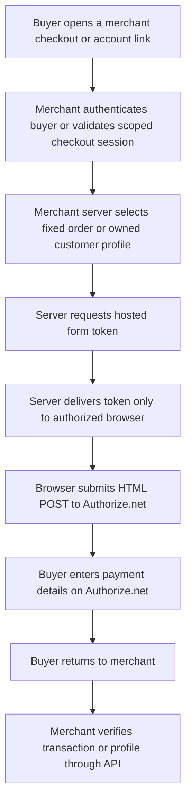

# Hosted checkout and payment profile capture

Authorize.net hosted forms require a trusted browser delivery mechanism. Both MCP runtimes keep form tokens out of tool responses. A merchant's checkout or account server can deliver a hosted form to the buyer without giving the buyer merchant credentials.

The missing dependency is a browser-only, authorized server endpoint that creates an Authorize.net form token and delivers it directly to the intended buyer's browser. Executor's current app UI requires an Executor session, has no public sharing, and calls the same tool router as MCP. It has no documented browser-only operation or invocation-source authorization boundary. Returning a token from an ordinary tool would make it available to an MCP client as well.

No checkout UI, form-token tool, public token URL, custom token encryption, OAuth integration, or additional server is included. Merchant API tools remain independent of this restriction.

## Buyer experience once a trusted bridge exists

The buyer never needs merchant credentials. The merchant needs its own API Login ID and Transaction Key. Customer profile identifiers belong to that merchant account and must be selected using the merchant's authenticated customer mapping, never a buyer-supplied profile identifier alone.

## Authorize.net contract

| Purpose | Server API operation | Production browser POST action | Sandbox browser POST action |
| --- | --- | --- | --- |
| Payment | `getHostedPaymentPageRequest` | `https://accept.authorize.net/payment/payment` | `https://test.authorize.net/payment/payment` |
| Manage customer profiles | `getHostedProfilePageRequest` | `https://accept.authorize.net/customer/manage` | `https://test.authorize.net/customer/manage` |
| Add payment profile | `getHostedProfilePageRequest` | `https://accept.authorize.net/customer/addPayment` | `https://test.authorize.net/customer/addPayment` |
| Edit payment profile | `getHostedProfilePageRequest` | `https://accept.authorize.net/customer/editPayment` | `https://test.authorize.net/customer/editPayment` |

Both products require an HTML form POST with a hidden `token` field. Editing one payment profile also requires the `paymentProfileId` field. Do not put the form token in a query string, fragment, chat, tool argument, tool result, logs, analytics, or browser storage.

Accept Hosted payment tokens expire after 15 minutes. The merchant server must fix the transaction type, amount, environment, customer association and permitted return URLs before requesting a token. A browser redirect or return URL is not payment confirmation. Verify the transaction with the merchant API before recording payment success.

Accept Customer requires a customer profile ID. First-time customers need a customer profile created before requesting the hosted form. Creating or changing a stored payment method does not itself establish payment success or authorize an unrelated charge.

A full-page POST avoids the iframe communicator dependency. Executor app pages send `frame-ancestors 'none'`, so the documented same-origin iframe communicator pattern cannot be hosted as an ordinary Executor app page.

## What would make implementation safe

Either Executor needs a documented browser-only response route that excludes its payload from MCP and tool-call records, with scoped buyer authorization and direct POST delivery, or the merchant must provide an existing trusted checkout/account server that already owns buyer authentication. App-wide merchant credentials alone do not establish which buyer may manage which customer profile.

A future bridge must bind each handoff to the merchant, environment, purpose and order or owned profile, enforce expiration and replay handling, and verify authoritative API results after the browser returns. Card numbers, card verification codes, bank details and opaque payment tokens must remain outside model arguments and results. This app must not silently replace the missing bridge with a shareable form-token URL.

## Evidence and verification limits

Research performed on 2026-11-19. No deployment, merchant connection, token request, payment, payment-profile change or live browser journey was performed.

- [Authorize.net Accept Hosted](https://developer.authorize.net/api/reference/features/accept-hosted.html) documents token issuance, expiration, browser POST delivery and iframe requirements.
- [Authorize.net Customer Profiles](https://developer.authorize.net/api/reference/features/customer-profiles.html) documents buyer identification, profile ownership requirements and Accept Customer browser actions.
- Executor live `app-authoring/ui.md` states that app UIs require browser sign-in, do not support public sharing and use `apps/client` references to tool operations. App pages send `frame-ancestors 'none'`.
- Executor live `app-authoring/accounts.md` distinguishes caller-owned `user` accounts from manager-linked `app` accounts. Neither scope grants a buyer access to a particular merchant customer profile.
- Executor framework reference `0.0.1-beta.143`, digest `0aba8e2ba231b96933686738bbcca271b0bbe0e79185bc8808e830dc69987a3f`, lists tools, skills, workflows, schedules and provider webhooks in `AppDefinition`. `AppContext` provides accounts, cache, packaged files, workflows, elicitation, fetch and cancellation, with no documented browser identity or trusted invocation-source field.
